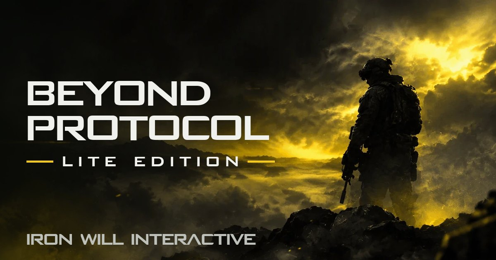

<div align="center">

<a href="https://gamedev44.github.io/BeyondProtocol_Lite/">
  
</a>

<a href="https://gamedev44.github.io/BeyondProtocol_Lite/">
  
</a>

<a id="beyond-protocol-lite-edition"></a>

# Beyond Protocol: Lite Edition

**A fast, free browser FPS by Iron Will Interactive.**
Solo against bots or online with friends, on phone or computer, with nothing to download.

**⚡ Quick Start:** [gamedev44.github.io/BeyondProtocol_Lite](https://gamedev44.github.io/BeyondProtocol_Lite/)

[](#whats-new)
[](#multiplayer)
[](#game-modes)
[](#maps)
[](#classes)

[](#install-as-an-app)
[](#tech-stack)
[](#tech-stack)
[](#tech-stack)
[](#multiplayer)
[](#install-as-an-app)

[](https://gamedev44.github.io/BeyondProtocol_Lite/)
[](https://github.com/gamedev44/BeyondProtocol_Lite/commits/main)
[](https://github.com/gamedev44/BeyondProtocol_Lite)
[](#legal-license)
[](#credits)

[Play](#play-now) · [Features](#features) · [Multiplayer](#multiplayer) · [Controls](#controls) · [Run Locally](#run-locally) · [Legal](#legal-license)

</div>

---

## 📑 Table of Contents

- [▶️ Play Now](#play-now)
- [🎯 About](#about)
- [✨ Features](#features)
- [🕹️ Game Modes](#game-modes)
- [🗺️ Maps](#maps)
- [🪖 Classes](#classes)
- [🌐 Multiplayer](#multiplayer)
- [⌨️ Controls](#controls)
- [📲 Install as an App](#install-as-an-app)
- [🧰 Tech Stack](#tech-stack)
- [📁 Repository Layout](#repository-layout)
- [💻 Run Locally](#run-locally)
- [🚀 Deploying to GitHub Pages](#deploying-to-github-pages)
- [📰 What's New](#whats-new)
- [🐞 Known Issues](#known-issues)
- [🛣️ Roadmap](#roadmap)
- [⚖️ Legal & License](#legal-license)
- [🙌 Credits](#credits)
- [📬 Contact](#contact)

---

<a id="play-now"></a>
## ▶️ Play Now

> **[gamedev44.github.io/BeyondProtocol_Lite](https://gamedev44.github.io/BeyondProtocol_Lite/)**

Open the link in any modern browser (Chrome, Edge, Firefox, Safari) on a computer, phone, tablet, or Steam Deck. No account, no download, no install required.

<sub>[⬆ Back to top](#beyond-protocol-lite-edition)</sub>

<a id="about"></a>
## 🎯 About

**Beyond Protocol: Lite Edition** is the web edition of Beyond Protocol, a fast-paced first-person shooter from **Iron Will Interactive**. It runs entirely in the browser as a single page, built with **BismuthJS** and **inspired by Basalt Engine**.

Jump straight into a match against bots, or send a link to friends and play together over peer-to-peer networking, with no game server needed.

<sub>[⬆ Back to top](#beyond-protocol-lite-edition)</sub>

<a id="features"></a>
## ✨ Features

| | |
|---|---|
| 🎮 **Instant play** | One page, loads in the browser, no download |
| 🤖 **Bots** | Full matches solo against AI opponents and allies |
| 🌐 **Online with friends** | Peer-to-peer lobbies through a shareable invite link |
| 🔫 **Loadouts** | Primary and secondary weapons, attachments, and camos |
| 💥 **Killstreaks** | Including a kamikaze drone and a mech |
| 👕 **Outfits** | Ten outfits, six of them unlockable |
| 📱 **Touch controls** | Full on-screen controls for phones and tablets |
| ⚙️ **Rebindable keys** | Every action can be remapped in Options |
| 📊 **Performance tools** | Frame rate caps and an in-game performance report |
| 📲 **Installable** | Works as an app (PWA) with offline caching |

<sub>[⬆ Back to top](#beyond-protocol-lite-edition)</sub>

<a id="game-modes"></a>
## 🕹️ Game Modes

| Mode | Format |
|---|---|
| **Team Deathmatch** | 6 vs 6 (you and 5 allies) |
| **Deathmatch** | Free for all, 8 players |
| **Domination** | 6 vs 6, hold three capture points |

<sub>[⬆ Back to top](#beyond-protocol-lite-edition)</sub>

<a id="maps"></a>
## 🗺️ Maps

| Map | Setting |
|---|---|
| **Khamsin** | Alley village |
| **Val-Blanc** | Snowbound mountain station |
| **Kervénec** | Fishing harbor and fish market |
| **Hortus** | Botanical garden and great greenhouse |
| **Meltem** | Cycladic island |
| **Tephra** | Volcano research station |
| **Stratus** | Floating islands |
| **Simoun** | Dune sea |
| **French Dream** | Suburban housing estate |

<sub>[⬆ Back to top](#beyond-protocol-lite-edition)</sub>

<a id="classes"></a>
## 🪖 Classes

| Class | Primary | Secondary |
|---|---|---|
| **Assault** | M4 | M9 |
| **Rusher** | MP5 | M9 |
| **Marksman** | L96 | M9 |
| **Breacher** | M1014 | M9 |
| **Gunner** | M249 | MGL |
| **Rocketeer** | RPG | Crossbow |

Weapons are built procedurally in code, and each class can be customized with attachments and camos.

<sub>[⬆ Back to top](#beyond-protocol-lite-edition)</sub>

<a id="multiplayer"></a>
## 🌐 Multiplayer

Online play is **peer-to-peer** over WebRTC using [PeerJS](https://peerjs.com/):

1. One player picks **Play → With friends → Create a lobby**, which creates a short code (for example `R3K7V`).
2. They share the invite link, which looks like `https://gamedev44.github.io/BeyondProtocol_Lite/?salon=R3K7V`.
3. Friends open the link and join directly. Up to **8 players** per lobby.

The host's browser runs the match and relays game state to everyone else. There is no dedicated game server, so the host should have a stable connection. If the host leaves, host migration hands the match to another player.

> [!NOTE]
> In peer-to-peer lobbies, other players (especially the host) can see your IP address. See the Privacy Policy in-game for details.

<sub>[⬆ Back to top](#beyond-protocol-lite-edition)</sub>

<a id="controls"></a>
## ⌨️ Controls

Default keyboard and mouse bindings. Every action can be rebound in **Options**.

| Action | Key |
|---|---|
| Move | <kbd>W</kbd> <kbd>A</kbd> <kbd>S</kbd> <kbd>D</kbd> |
| Jump | <kbd>Space</kbd> |
| Sprint / hold breath when scoped | <kbd>Shift</kbd> |
| Crouch (hold) / slide while sprinting | <kbd>Ctrl</kbd> |
| Crouch (toggle) / slide while sprinting | <kbd>C</kbd> |
| Fire / aim | <kbd>Left Mouse</kbd> / <kbd>Right Mouse</kbd> |
| Reload | <kbd>R</kbd> |
| Primary / secondary weapon | <kbd>1</kbd> / <kbd>2</kbd> |
| Switch weapon | <kbd>Q</kbd> |
| Knife | <kbd>F</kbd> |
| Grenade | <kbd>G</kbd> |
| Pick up weapon / use | <kbd>E</kbd> |
| Inspect weapon | <kbd>I</kbd> |
| Killstreaks | <kbd>4</kbd> <kbd>5</kbd> <kbd>6</kbd> |
| Third-person toggle | <kbd>V</kbd> |
| Scoreboard | <kbd>Tab</kbd> |
| Pause | <kbd>Esc</kbd> |

On phones and tablets, on-screen touch controls appear automatically.

<sub>[⬆ Back to top](#beyond-protocol-lite-edition)</sub>

<a id="install-as-an-app"></a>
## 📲 Install as an App

Beyond Protocol: Lite Edition is a **Progressive Web App**:

- **Desktop (Chrome / Edge):** click the install icon in the address bar.
- **Android:** browser menu → *Add to Home screen*.
- **iPhone / iPad (Safari):** Share → *Add to Home Screen*.
- **Steam Deck:** an installer is included in [`deck/`](deck/) to add the game to Game Mode.

Once installed, textures, sounds, and maps are cached for faster loading.

<sub>[⬆ Back to top](#beyond-protocol-lite-edition)</sub>

<a id="tech-stack"></a>
## 🧰 Tech Stack

| Layer | Technology |
|---|---|
| Engine | **BismuthJS**, inspired by **Basalt Engine** |
| Rendering | [three.js](https://threejs.org/) (WebGL) |
| Networking | [PeerJS](https://peerjs.com/) (WebRTC, peer-to-peer) |
| Packaging | Single HTML page with fingerprinted assets |
| Offline | Service worker (`sw.js`) and web app manifest |
| Hosting | [GitHub Pages](https://pages.github.com/) |

<sub>[⬆ Back to top](#beyond-protocol-lite-edition)</sub>

<a id="repository-layout"></a>
## 📁 Repository Layout

```text
BeyondProtocol_Lite/
├── index.html                       # Entry point, redirects to the game page (keeps ?salon= invite codes)
├── BeyondProtocol-Lite-Edition.html # The game (single page)
├── sw.js                            # Service worker (offline caching)
├── manifest.webmanifest             # PWA manifest
├── version.json                     # Current build ID, used by the in-game update check
├── icons/                           # App icons and the social preview image
├── maps/                            # Map preview images
├── tex/                             # Textures and engine scripts
├── sfx/                             # Sound effects
├── deck/                            # Steam Deck installer
├── menu-theme.mp3                   # Main menu music
├── black-ops-2.ttf                  # Title font
├── robots.txt / sitemap.xml         # Search engine files
└── favicon.ico
```

<sub>[⬆ Back to top](#beyond-protocol-lite-edition)</sub>

<a id="run-locally"></a>
## 💻 Run Locally

The game needs to be served over HTTP (opening the file directly will not load assets or multiplayer).

```bash
git clone https://github.com/gamedev44/BeyondProtocol_Lite.git
cd BeyondProtocol_Lite
python -m http.server 8000
```

Then open **http://localhost:8000/** in your browser.

<sub>[⬆ Back to top](#beyond-protocol-lite-edition)</sub>

<a id="deploying-to-github-pages"></a>
## 🚀 Deploying to GitHub Pages

1. Push to the `main` branch.
2. In the repository, go to **Settings → Pages**.
3. Under **Build and deployment**, choose **Deploy from a branch**, then `main` and `/ (root)`.
4. The site goes live at `https://gamedev44.github.io/BeyondProtocol_Lite/`.

All asset paths are relative, so the game works from the repository subfolder without changes.

<sub>[⬆ Back to top](#beyond-protocol-lite-edition)</sub>

<a id="whats-new"></a>
## 📰 What's New

**Version 6.0.0, November 7, 2026** (by gamedev44)

- Now live on GitHub Pages.
- Rebranded as Beyond Protocol: Lite Edition by Iron Will Interactive.
- Larger, responsive main menu title that reads clearly from small phones to large monitors.
- New link preview image and social tags for Discord and other apps.
- Legal pages updated for US and Oklahoma law.

The full update history is in the game under **What's new**.

<sub>[⬆ Back to top](#beyond-protocol-lite-edition)</sub>

<a id="known-issues"></a>
## 🐞 Known Issues

- **No account server yet.** Profiles, sign-in, and cloud saves are turned off on this build. Your progress and settings are kept only in your current browser, so they will not carry over to another device and are lost if you clear the site's data. Player accounts are planned (see [Roadmap](#roadmap)).

Found something else? [Open an issue](https://github.com/gamedev44/BeyondProtocol_Lite/issues).

<sub>[⬆ Back to top](#beyond-protocol-lite-edition)</sub>

<a id="roadmap"></a>
## 🛣️ Roadmap

- [ ] Player accounts and cloud progression (planned database: PlanetScale)
- [ ] More maps and weapons
- [ ] Dedicated relay option for players behind strict networks

<sub>[⬆ Back to top](#beyond-protocol-lite-edition)</sub>

<a id="legal-license"></a>
## ⚖️ Legal & License

© 2026 **IronWill Interactive Entertainment ("IWI")**. All rights reserved.

The game, its code, and its original content are the property of Iron Will Interactive. Copying, redistributing, or modifying this project without written permission is not allowed. The in-game **Privacy and terms** page contains the full Terms of Use and Privacy Policy, governed by the laws of the State of Oklahoma and the United States.

Third-party textures and skies are licensed separately under CC0 (see [Credits](#credits)).

<sub>[⬆ Back to top](#beyond-protocol-lite-edition)</sub>

<a id="credits"></a>
## 🙌 Credits

- **Developer and publisher:** Iron Will Interactive
- **Map credits:** Ironwill
- **Engine:** BismuthJS, inspired by Basalt Engine
- **Textures and skies:** [Poly Haven](https://polyhaven.com/) and [ambientCG](https://ambientcg.com/), CC0
- **Lighting:** Poly Haven HDRIs via [@pmndrs/assets](https://github.com/pmndrs/assets), CC0
- **Libraries:** [three.js](https://threejs.org/), [PeerJS](https://peerjs.com/)

<sub>[⬆ Back to top](#beyond-protocol-lite-edition)</sub>

<a id="contact"></a>
## 📬 Contact

- **Email:** [ironwillinteractive@gmail.com](mailto:ironwillinteractive@gmail.com)
- **Issues and feedback:** [GitHub Issues](https://github.com/gamedev44/BeyondProtocol_Lite/issues)
- **Discord:** coming soon

<div align="center">

**Beyond Protocol Lite Edition made by Iron Will Interactive using Bismuth JS inspired by Basalt Engine**

[](https://gamedev44.github.io/BeyondProtocol_Lite/)

</div>
